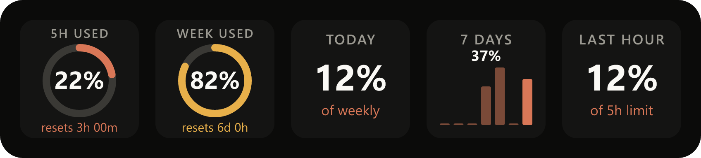

# Claude Usage for Stream Deck

**Know exactly how much Claude you have left, at a glance, without ever typing `/usage` again.**

Claude Usage puts your Claude Pro/Max limits on your Stream Deck as live, color-coded gauges. See how much of
your 5-hour window and weekly limit you've used, when each one resets, and how fast you're burning through it.
Stop getting surprised by "usage limit reached" in the middle of a flow.



## Why you'll love it

- 🎯 **Real numbers, not guesses.** The percentages come straight from Claude Code, the same figures `/usage` shows.
  Usage from claude.ai and the desktop app counts too.
- 🚦 **Warns you before it's a problem.** Rings glow Claude orange normally, turn amber at 75% and red at 90%.
- ⏱️ **Countdown to reset.** Every gauge tells you exactly when your window frees up again.
- 📊 **See your pace.** Track how much of your weekly limit you used today, this week, this month, or in the last
  hour, plus a 7-day bar chart of your daily usage.
- 🔒 **100% local and private.** No API keys, no logins, no network calls. It reads files Claude Code already writes
  on your machine, and nothing ever leaves it.
- 👆 **One key, every stat.** Press any key to cycle through stats, or drop several on your deck for a full
  dashboard.

## What you can show

| Key | What it tells you |
| --- | --- |
| **5-hour limit used** | Ring gauge of your current 5-hour window, with time until reset |
| **Weekly limit used** | Ring gauge of your 7-day limit, with time until reset |
| **Used today** | How much of your weekly limit you've used since midnight |
| **Used last 7 days** | How much of your weekly limit you've used over the past week |
| **Used this month** | Your weekly-limit usage added up for the month (yes, it can pass 100%) |
| **Used last hour** | How much of your 5-hour limit the last 60 minutes used: your burn rate |
| **7-day chart** | Daily usage bars, with today highlighted |
| **Tokens today** | Total tokens Claude Code processed today, plus output tokens |
| **Messages today** | Claude replies today, plus how many sessions |
| **Session context** | How full each active session's context window is, fullest first (a ring when only one is open) |

Keys refresh every 15 seconds.

## Get started in 5 minutes

**You'll need:** a Stream Deck with Stream Deck software 7.1+, Node.js 20+, and
[Claude Code](https://code.claude.com) signed in with a Claude Pro or Max plan.

**1. Build and install the plugin**

```sh
git clone <this repo>
cd <repo folder>
npm install
npm run build
npx streamdeck dev      # turn on Stream Deck developer mode (needed for local plugins)
npm run link            # install the plugin into Stream Deck
```

Restart the Stream Deck app, and **Claude Usage** appears in your actions list.

**2. Connect Claude Code**

Add this to `~/.claude/settings.json`, pointing at where you cloned the repo:

```json
"statusLine": {
  "type": "command",
  "command": "node \"/path/to/repo/statusline/statusline.mjs\""
}
```

As a bonus, your Claude Code status line now shows your limits too:
`Opus 5.5 · ctx 12% · 5h 24% used · week 5% used`

> Already have a custom status line? This replaces it, so copy your old `statusLine` entry somewhere first if
> you want to merge the two.

**Using Claude Code in WSL too?** WSL has its own `~/.claude`, so add the status line there as well, and point
`--dir` at your Windows `.claude` folder so both share one history:

```json
"statusLine": {
  "type": "command",
  "command": "node /mnt/c/path/to/repo/statusline/statusline.mjs --dir /mnt/c/Users/<you>/.claude"
}
```

The plugin also reads token and message counts from the transcripts of any running WSL distro. It never starts
a stopped distro; counts it has already read stay on the keys until the plugin restarts.

**3. Drag, drop, done**

Drag **Claude Usage → Usage Stat** onto any key. Pick a stat in the settings panel, or just press the key to
cycle through them.

## How it works

Claude Code hands your account's live limit data (`rate_limits`) to its status line command every time Claude
replies. The included status line script saves those numbers to `~/.claude/streamdeck-usage.json` and keeps a
small history in `~/.claude/streamdeck-usage-history.jsonl`. It also records each session's context usage in
`~/.claude/streamdeck-sessions.json`. The plugin reads both, plus Claude Code's own
session files for token and message counts.

That's the whole pipeline: no servers, no scraping, no credentials.

## Good to know

- **Updates when Claude Code is active.** Limits refresh whenever a Claude Code session gets a reply. If the
  data is more than an hour old, the ring turns grey and shows how old it is, so you never mistake stale numbers
  for live ones. When a window resets, the key drops back to 0% on its own.
- **History builds over time.** "Today", "7 days", "month" and "last hour" are worked out from saved readings,
  so on day one they only cover usage since you installed. Until the history spans the full period the key says
  "since …".
- **Session context shows sessions with a reply in the last hour.** A session's number updates when it gets a
  reply, and a closed session drops off the key an hour after its last one.
- **Pro and Max plans only.** Claude Code only reports limits for claude.ai subscribers.

## Development

```sh
npm run watch          # rebuild and restart the plugin on every change
npm run test:stats     # print the stats the keys would show; add `-- <dir>` to dump key SVGs
npm run validate       # check the manifest with the Elgato CLI
npm run pack           # build a .streamDeckPlugin installer
```

Built with the [Elgato Stream Deck SDK](https://docs.elgato.com/streamdeck/sdk/introduction/getting-started/).
Restarting the plugin from the CLI needs developer mode (`npx streamdeck dev`).
